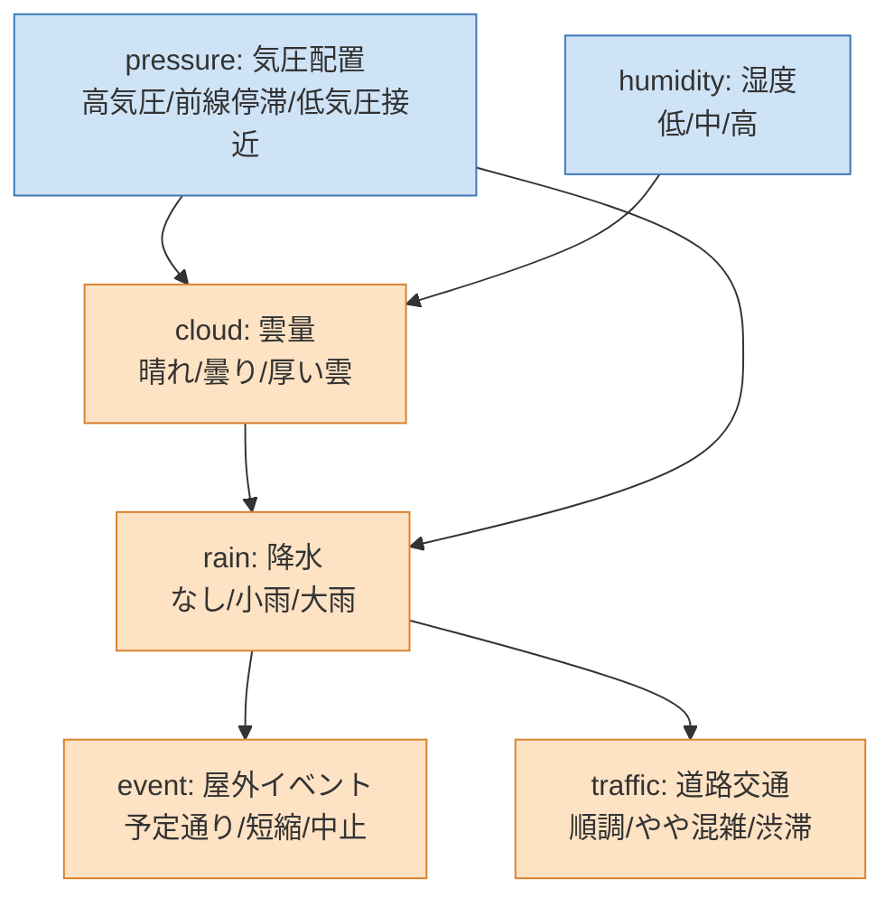
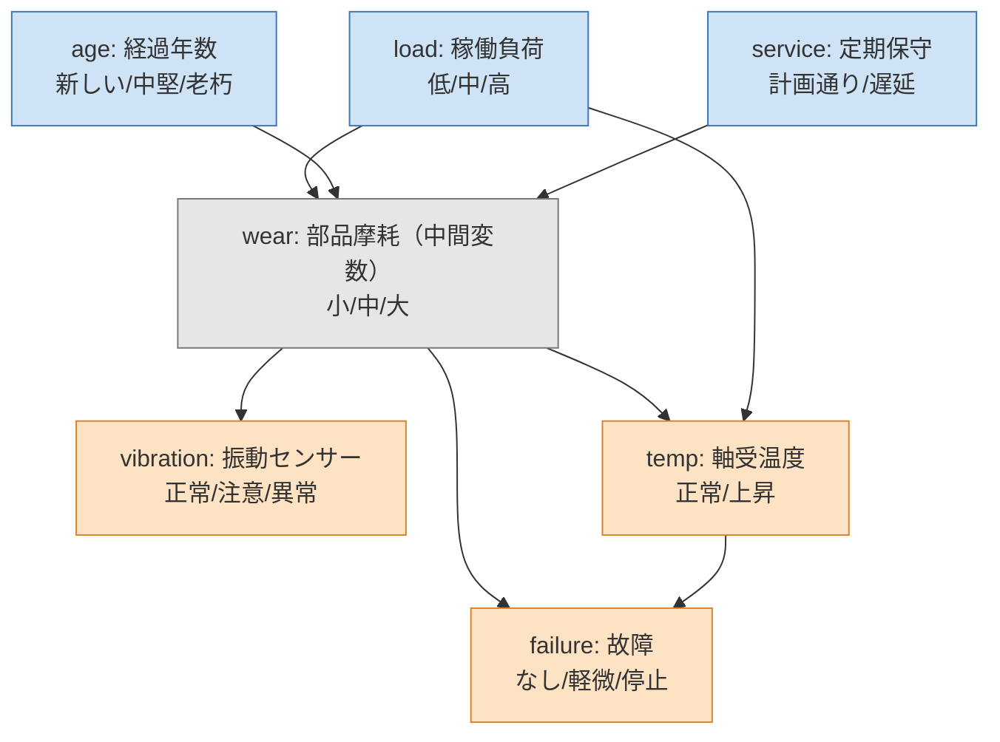

# fxtensor-bayesnet

[English](README.md) | **日本語**

設定ファイル駆動の離散ベイジアンネットワーク推論ツール（[fxtensor-salmon](https://github.com/salmonsnare/fxtensor-salmon) 使用）。

## 概要

本ツールは、事象間の因果関係を条件付き確率で表現し、全体への影響を定量的に評価する意思決定支援ツールです。前提条件や確率は設定ファイルで管理するため、システムを改修することなく迅速に見直せます。複数シナリオの比較分析に加え、観測された結果から要因を逆算する分析にも対応しています。日次で設定と結果を記録するため、判断の根拠と変化の経緯を継続的に追跡できます。

仕組み：

- 各変数は有限個のラベル（例：`晴れ / 曇り / 厚い雲`）をとる離散変数です。
- 親を持たない変数（根）には事前分布、子の変数には「親のラベルの組合せ → 子の分布」の条件付き確率表（マルコフ核）を書きます。
- fxtensor-salmon の `FXTensor` で状態と核を合成して同時分布を作り、シナリオごとの周辺分布、観測による条件付け（ベイズ更新）、`bayesian_inversion` による根の要因の逆算を計算します。
- 毎回、ライブラリでの計算結果を numpy `einsum` の直接計算と丸め前の値で突き合わせ、ずれがあれば停止します（結果の `検算` 欄）。
- 同時分布の要素数が 200 万を超えると、自動的に「祖先集合だけの einsum」計算に切り替わります（結果は同じ）。条件付けでは 100 万要素を超える密な配線核を作らず、同時分布の直接和か変数消去（einsum）で計算します。
- 因果の問い（0.10.0）：`interventions` で根に限らず任意の変数に do 演算（グラフ手術）をかけられます。`effects` は平均因果効果（ACE）を観測上の差と並べて出すので、交絡の大きさが見えます。
- 観測は複数の証拠の同時の条件付けと、ソフト証拠（尤度）に対応します。`sensitivity` は結果がどの事前分布・CPT の値に強く依存するかを順位付けします。
- `--plot` でネットワーク構造図・シナリオ比較・ベイズ更新・前回からの変化量の図を PNG / SVG で出力できます（matplotlib が必要）。

> 設定に書く確率は利用者の仮定です。結果は仮定の帰結であり、仮定そのものの正しさは保証しません。

## インストール

Python 3.8 以上。PyPI から入れます。

```bash
pip install fxtensor-bayesnet            # 本体（numpy と fxtensor-salmon が入ります）
pip install "fxtensor-bayesnet[plot]"    # 図も使う場合（matplotlib も入ります）
```

開発する場合：

```bash
git clone https://github.com/salmonsnare/fxtensor-bayesnet.git
cd fxtensor-bayesnet
python3 -m venv .venv
. .venv/bin/activate
pip install -e ".[dev]"     # pytest・matplotlib 付き
pytest
```

## 使い方（すぐ試す）

例題の設定は `examples/` にあります（PyPI のパッケージには含まれないので、リポジトリから取得してください）。

```bash
curl -O https://raw.githubusercontent.com/salmonsnare/fxtensor-bayesnet/v0.11.1/examples/weather/config.json
fxtensor-bayesnet --check                       # 既定はカレントディレクトリの config.json
fxtensor-bayesnet --no-write --md               # Markdown を標準出力へ
fxtensor-bayesnet --no-write --plot --out-dir out/   # 図だけ out/ に
# python -m fxtensor_bayesnet ... でも同じ
```

## config の書き方

設定は JSON 1 ファイルです。最小例：

```json
{
  "as_of": "2026-10-10",
  "horizon": "翌日",
  "note": "全確率は仮定値",
  "variables": {
    "cloud": {"name": "雲量", "labels": ["晴れ", "曇り"]},
    "rain":  {"name": "降水", "labels": ["なし", "あり"]}
  },
  "priors": {
    "cloud": {"p": [0.6, 0.4], "reason": "根拠のメモ（任意）"}
  },
  "kernels": {
    "rain": {
      "parents": ["cloud"],
      "reason": "根拠のメモ（任意）",
      "cpt": {
        "晴れ": [0.95, 0.05],
        "曇り": [0.6, 0.4]
      }
    }
  },
  "scenarios": {
    "A:曇りがち": {"cloud": [0.2, 0.8]}
  },
  "observations": [
    {"var": "rain", "label": "あり", "focus": ["cloud"]}
  ],
  "outputs": ["rain"]
}
```

| キー | 必須 | 内容 |
|---|---|---|
| `as_of` | ○ | 基準日（`YYYY-MM-DD`）。スナップショットのフォルダ名になる |
| `horizon` / `note` | | 見通しの期間・注意書き（結果に表示） |
| `variables` | ○ | 変数名 → `{"name": 表示名, "labels": [ラベル…]}`。ラベルは 2 個以上・重複なし |
| `priors` | ○ | 根の変数 → `{"p": [各ラベルの確率], "reason": 任意}`。和は 1 |
| `kernels` | ○ | 子の変数 → `{"parents": [親…], "cpt": {...}, "reason": 任意}` |
| `scenarios` | | シナリオ名 → `{根の変数: 差し替える事前分布}`。「基本」は自動で入る |
| `observations` | | `{"var", "label", "focus"}`。`var=label` を観測したときの事後を計算。`focus` の変数は事前→事後の動き（差・全変動距離 TV・KL）と動きの大きさ順を出す（省略時は根すべて）。`var`/`label` の代わりに `{"evidence": {...}, "name": 任意}` と書くと、複数の観測を同時に条件付けでき、ソフト証拠も書ける（下記） |
| `interventions` | | 介入名 → `{変数: ラベル or [分布]}`。**任意の変数**への do 演算（その変数の核を差し替えるグラフ手術）。`outputs` の周辺分布を出す |
| `effects` | | `{"treatment", "outcome", "outcome_label"?, "treated"?, "control"?}` のリスト。各水準の P(outcome \| do(X=x)) と P(outcome \| X=x)、ACE（treated − control）、観測上の差、その差（交絡）を出す。既定は outcome の最後のラベル、treated＝最後のラベル、control＝最初のラベル。`given_do` / `given` で層別・条件付き ACE も出せる。任意の `name` は結果のキーになる（後述） |
| `sensitivity` | | `{"target", "label"?, "delta"?（0.05）, "top"?（10）}` またはそのリスト。P(target=label) の、各事前分布・CPT の値への一変数ずつの感度 |
| `outputs` | | 結果表に出す変数（省略時は根以外すべて） |

`cpt` の書き方：

- キーは親のラベルを `parents` の順に `|` でつないだもの（例：親が `["load", "age"]` なら `"高|老朽"`）。
- 値は子のラベル順の確率で、各行の和は 1。
- 親のラベルの全組合せの行が必要です（足りない・余分な行は `--check` でエラー）。
- 各変数は `priors` か `kernels` のどちらか一方にだけ書きます。循環は不可。変数は最大 52 個。
- `variables` での変数の並び順は自由です（根を先に並べる必要はありません）。

### 介入・因果効果・証拠・感度分析

いずれも省略可能で、書かなければ結果は従来と同じです。設備保全の例（`examples/maintenance/config.json`）に足す例：

```json
"interventions": {
  "部品交換（wear=小）": {"wear": "小"},
  "軸受の半数を冷却": {"temp": [0.5, 0.5]}
},
"effects": [
  {"treatment": "temp", "outcome": "failure", "outcome_label": "停止"},
  {"treatment": "wear", "outcome": "failure", "outcome_label": "停止", "treated": "大", "control": "小"}
],
"observations": [
  {"evidence": {"vibration": "異常", "temp": "上昇"}, "focus": ["load", "age", "service"]},
  {"name": "振動はおそらく異常（誤差のあるセンサー）",
   "evidence": {"vibration": {"likelihood": [0.1, 0.4, 0.9]}}, "focus": ["wear"]}
],
"sensitivity": {"target": "failure", "label": "停止", "delta": 0.05, "top": 5}
```

- **`interventions`**：`{"wear": "小"}` はハードな do(wear=小)、`[0.5, 0.5]` のようなリストは確率的な介入です。その変数に入る辺を切り、下流をすべて計算し直します。上流の変数は事前分布のまま（条件付けとの違い）。根の事前分布を変えるには従来どおり `scenarios` を使います（根への do はシナリオと同じ）。
- **`effects`**：条件付けと介入を比べます。上の例では、軸受温度の上昇は停止の +14.9pt 増と結びついていますが、do(temp) の ACE は +5.8pt だけで、差の +9.1pt は部品摩耗を通じた交絡です。
- **`evidence`**：ラベルの文字列はハードな証拠、`{"likelihood": [...]}` はソフト（仮想）証拠です。各ラベルの非負の重み P(報告 \| 真のラベル) で、和が 1 でなくてもかまいません（誤差のあるセンサーや不完全な検出など）。1 項目の証拠はすべて同時に条件付けます。ハード証拠の変数は事後から除き、ソフト証拠の変数は事後を出します。結果のキーは `name`、なければ `vibration=異常, temp=上昇 を観測` のようになります。
  ハード証拠だけの更新には証拠の事前確率 `観測前の確率`（`evidence_probability`）を出します。ソフト証拠を含む項目では代わりに `尤度の期待値`（`expected_likelihood`）を出します。これは尤度の重みの期待値 Σ P(x) L(x) で、確率ではなく、重みが 1 を超えれば 1 を超えることもあります（% ではなく数値で表示）。
  モデルの下で確率 0 の観測（CPT の値がすべて 0 のラベルなど）は条件付けできません。その場合も実行は止まりません。警告を出してその観測の更新だけを省き、`不可能な観測: true`（`impossible`）・確率 0・空の事後として結果に記録し、ほかの観測や項目は通常どおり計算します（`updates.png` には描きません）。
- **`sensitivity`**：目的変数の祖先集合にある各パラメータ（事前分布の 1 要素、または CPT の 1 行の 1 要素）を ±delta 動かし（[0, 1] に切り詰め）、同じ行の残りは比例的に縮めて和を 1 に保ちます。2 ラベルの行は最後のラベルだけ動かします。幅の大きい順に並べます（`--plot` でトルネード図）。

`--md` の出力（抜粋）：

```
### temp → failure=停止
| 水準 | P(failure=停止 ∣ temp=水準)（観測） | P(failure=停止 ∣ do(temp=水準))（介入） |
|---|---|---|
| 正常 | 1.9% | 2.6% |
| 上昇 | 16.8% | 8.4% |

- 観測上の差（上昇−正常）+14.9pt / 平均因果効果 ACE +5.8pt / 差（交絡による分）+9.1pt
```

介入の結果は、元のネットワークでの切断因子分解（truncated factorization）の einsum と照合します（検算の `介入:切断因子分解との最大差`）。

### 層別 ACE・条件付き ACE（`given_do` / `given`、0.11.0）

X の効果が別の変数 Z によって変わるか（効果修飾）を調べるには、do の組み合わせをすべて `interventions` に書く代わりに、`effects` の項目に `given_do` や `given` を足します。

```json
{"treatment": "temp", "outcome": "failure", "outcome_label": "停止",
 "given_do": {"wear": ["小", "大"]},
 "given": {"load": null}}
```

- **`given_do`**：`{Z: [ラベル]}`。Z も介入で固定します。層 z ごとに、各水準 x の P(Y=y \| do(X=x), do(Z=z)) と ACE(z) = P(y \| do(treated), do(z)) − P(y \| do(control), do(z)) を出します。
- **`given`**：`{Z: [ラベル]}`。条件付き ACE です。X を介入で固定したモデルの中で Z を観測して条件付けた P(Y=y \| do(X=x), Z=z) を使います。do(X=x) の下で確率 0 の層は未定義（`null`、表示は `—`）とし、警告を出します。
- 値はラベルのリスト、ラベル 1 つ、または `null`（全ラベル）。複数の変数を書くと、ラベルの組み合わせが層になります（例 `wear=大, load=低`）。Z は treatment・outcome と別の変数で、同じ変数を両方のキーには書けません。
- **結果のキー（0.11.1）**：`name` があればそれをキーにします（`名前` / `name` としても残ります）。なければ `X → Y=y` に層の指定を続けます。`given_do` なら `X → Y=y | do(Z)`、`given` なら `X → Y=y | W`、両方なら `X → Y=y | do(Z), W`。`given_do` / `given` のない effects は従来どおり `X → Y=y` です。これで同じ (treatment, outcome, outcome_label) を層の指定を変えて何件でも書けます。それでもキーが重なる場合（同じ `given_do` の変数でラベルだけ違う、など）は、`--check` が設定エラーにし、`run()` も最後の 1 件だけを黙って残さずに `ConfigError` を出します。`name` を付けて区別してください。
- 層ごとの値は因果効果の `層別ACE(given_do)` / `条件付きACE(given)`（`stratified_ace_given_do` / `conditional_ace_given`）に入り、最後の層と最初の層の ACE の差（`層間のACEの差(最後−最初)`、`ace_difference_last_minus_first`）も出します。Markdown には層別の表、`effects.png` には層ごとの ACE の棒グラフ（破線は全体の ACE）が加わります。これらのキーがない effects の出力は変わりません。

保守の例では、do(temp) の ACE は摩耗を「小」に固定すると +1.5pt、「大」に固定すると +20.0pt です。

```
#### 層別 ACE（wear を介入で固定：given_do）

| 層 | P(failure=停止 ∣ do(temp=正常), do(層)) | P(failure=停止 ∣ do(temp=上昇), do(層)) | ACE |
|---|---|---|---|
| wear=小 | 0.5% | 2.0% | +1.5pt |
| wear=大 | 10.0% | 30.0% | +20.0pt |

- 層間の ACE の差（wear=大 − wear=小）+18.5pt
```

処置の水準がモデルの下で確率 0 のとき、P(outcome \| X=x) は未定義です。`results.json` は `null` にしてその水準を `観測確率0の水準`（`zero_probability_levels`）に挙げ、警告を出します。Markdown は `—` と注記、`effects.png` はその水準の観測の棒を描かずに「未定義 (P=0)」と記します（介入側の値と ACE は定義されます）。

## CLI

```
fxtensor-bayesnet [--config PATH] [options]
```

| オプション | 内容 |
|---|---|
| `--config PATH` | 設定ファイル（既定：カレントディレクトリの `config.json`） |
| `--check` | 設定の検証だけ行う（各行の和=1、欠けた・余分な行、未定義の親、循環など）。エラーは全件表示し終了コード 2 |
| `--no-write` | `results.json` / `results.md` / `model.mmd` を書かず、標準出力だけにする |
| `--md` | 標準出力を Markdown にする（既定は JSON） |
| `--lang ja\|en` | Markdown と図の見出し・凡例の言語（既定 `ja`）。`results.json` のキーには影響しない |
| `--json-keys ja\|en` | `results.json` と標準出力の JSON のキーの言語（既定 `ja`。0.9 と同じ）。`history/` のスナップショットは `--diff` のため常に日本語キー。下の「結果のキー」を参照 |
| `--snapshot` | 設定と結果を `<history-dir>/<as_of>/` に保存。そのフォルダが既にあれば（`--force` なしのとき）、何も書かずに（結果・図・スナップショットとも）終了コード 1 で止まる |
| `--force` | `--snapshot` の上書きを許可 |
| `--diff [PATH]` | スナップショットとの差分（設定の変更点（reason や、経路を変えた核の新旧の行も含む）＋結果の 0.1pt 以上の変化）。PATH にはスナップショットのフォルダ（中の `config.json` と `results.json` を使う）か `config.json` を指定。存在しないパスは終了コード 2。PATH 省略時は `as_of` **より前**で最新の日付を使い、**`as_of` と同じ日付のスナップショットは自動では比較対象にならない**（比べたいときは `--diff history/2026-10-10` のように明示） |
| `--format-config` | 設定ファイルを読みやすい形（核の 1 行＝1 行）に整形して書き戻す |
| `--out-dir DIR` | 結果ファイル・図の出力先（既定：設定ファイルと同じフォルダ） |
| `--history-dir DIR` | スナップショットの保存先（既定：設定ファイルと同じフォルダの `history/`） |
| `--plot` | 図を `--out-dir` に出力（下記）。`--no-write` と併用しても図は書く。`--check` のときは無視 |
| `--plot-format F…` | 図の形式 `png` / `svg`（複数指定可。既定 `png`） |
| `--plot-dpi N` | PNG の解像度（既定 150） |

出力ファイル：

- `results.json` … 事前分布、シナリオ別の周辺分布、ベイズ更新、介入、因果効果、感度分析、検算
- `results.md` … シナリオ比較表とベイズ更新の要約
- `model.mmd` … 変数と経路の構造図（mermaid。根・中間・出力を色分け）

### 図の出力（`--plot`）

matplotlib が必要です（`pip install "fxtensor-bayesnet[plot]"`）。入っていない状態で `--plot` を付けると、入れ方を表示して終了コード 3 で終わります（図を使わない機能は matplotlib なしで動きます）。

| ファイル | 内容 | 出るとき |
|---|---|---|
| `network.png` | ネットワーク構造図。根（青）・中間変数（灰）・出力変数（橙）を色分けし、階層レイアウトで描く（graphviz 不要） | 通常の実行 |
| `marginals.png` | 出力変数ごとの周辺分布の棒グラフ。シナリオを並べて比較 | 通常の実行 |
| `updates.png` | 観測ごとに、注目変数の事前・事後を並べた棒グラフ（全変動距離 TV 付き） | `observations` があるとき |
| `effects.png` | 因果効果ごとに、観測 P(outcome \| X=x) と介入 P(outcome \| do(X=x)) を並べた棒グラフ（観測上の差と ACE 付き）。観測上の確率 0 の水準は 0 の棒ではなく「未定義」と表示。`given_do` / `given` の層別 ACE は別のパネル | `effects` があるとき |
| `sensitivity.png` | 感度分析のトルネード図 | `sensitivity` があるとき |
| `diff.png` | 前回スナップショットからの周辺分布の変化量（pt）。シナリオごと | `--diff --plot` で、前回の `results.json` があるとき |

```bash
fxtensor-bayesnet --plot                          # 結果ファイル＋図（network / marginals / updates）
fxtensor-bayesnet --plot --plot-format png svg    # PNG と SVG の両方
fxtensor-bayesnet --no-write --plot --out-dir figs/
fxtensor-bayesnet --diff --plot                   # 前回との差分＋ diff.png
```

日本語フォントは Noto Sans CJK JP・IPAexGothic・Hiragino Sans・Yu Gothic・Meiryo などから自動で選びます。見つからない場合は警告を出して既定フォントで描きます（日本語が表示されないことがあります）。使うフォントは環境変数 `FXTENSOR_BAYESNET_FONT` で指定できます。SVG は文字をパスにして保存するので、閲覧環境のフォントに左右されません。

### 日次の運用例

```bash
cd my-model/                         # config.json があるフォルダ
# 1. config.json の as_of・priors・必要なら kernels を更新
fxtensor-bayesnet --check            # 検証
fxtensor-bayesnet --diff             # 前回（as_of より前の日付）との差分
fxtensor-bayesnet --snapshot --md    # 実行して results.* を更新し history/<as_of>/ に記録
fxtensor-bayesnet --plot --no-write  # 図を更新
```

## 例

`examples/` に 3 つの例題があります（確率は説明用の仮定値）。天気と設備保全には日本語版 `config.json` と、数値が同じ英語版 `config.en.json` があります。生態学の例は英語版だけです。下の図は `python docs/make_images.py` で実際に生成したもので、`docs/images/`（英語版は `docs/images/en/`）にあります。

### 天気（`examples/weather/config.json`）

- シナリオ：「A:台風接近」「B:乾燥した晴天続き」
- 観測：`rain=大雨`、`traffic=渋滞`、`event=中止` から気圧配置・湿度を逆算

構造（mermaid。GitHub ではそのまま図として表示されます）：



ネットワーク構造図（`--plot` の `network.png`）：


周辺分布のシナリオ比較（`marginals.png`）：


ベイズ更新の事前・事後（`updates.png`）。たとえば「大雨」を観測すると、気圧配置の「低気圧接近」が 25% → 67% に上がります：


前回からの変化量（`--diff --plot` の `diff.png`）。翌日に気圧配置と湿度の事前分布を見直した場合の例です。A・B は気圧配置（B は湿度も）をシナリオで上書きしているため、その分だけ変化が小さく（B は変化なし）なります：


### 設備保全（`examples/maintenance/config.json`）

- シナリオ：「A:繁忙期（高負荷）」「B:保守体制の強化」
- 観測：`vibration=異常`、`failure=停止`、`temp=上昇` から負荷・年数・保守状況を逆算
- `wear`（部品摩耗）は `outputs` に入れていない中間変数なので、構造図では灰色になります




実行例（設備保全、`--md` の抜粋）：

```
## failure（故障）
| シナリオ | なし | 軽微 | 停止 |
|---|---|---|---|
| 基本 | 85.9% | 9.2% | 4.9% |
| A:繁忙期（高負荷） | 83.2% | 10.7% | 6.1% |
| B:保守体制の強化 | 86.8% | 8.7% | 4.5% |

### vibration=異常 を観測（観測前の確率 11.2%）
- wear: 小 8.5% / 中 32.2% / 大 59.3%
- 動きの大きさ順(TV): age > load > service
```

### 生態学：宿主–寄生者–捕食寄生者のカスケード（`examples/ecology_host_parasitoid/`）

`interventions`・`effects`・同時／ソフト証拠・`sensitivity` を使った「観測と介入の違い」の例です（英語。[README](https://github.com/salmonsnare/fxtensor-bayesnet/blob/main/examples/ecology_host_parasitoid/README.md)）。**数値はすべて例示用の仮の値**です。題材は Coroller-Chouraki et al.（bioRxiv、https://doi.org/10.64898/2026.10.06.757064）を参考にしましたが、値はその論文からの推定ではありません。


## 結果のキー

`results.json` のキーは既定では日本語です（0.9 から変わりません）。`--json-keys en`（Python では `to_english_keys(res)`）で英語キーになります。利用者が付けた名前（変数・ラベル・シナリオ・介入の名前）は変換しません。観測のキー `X=x を観測` は `X=x` になります。将来のメジャーバージョンで既定を英語に変える可能性があります。

| 日本語 | 英語 | 日本語 | 英語 |
|---|---|---|---|
| `基準日` | `as_of` | `介入` / `介入内容` | `interventions` / `do` |
| `シナリオ` / `基本` | `scenarios` / `base` | `因果効果` | `effects` |
| `上書き` / `周辺` | `overrides` / `marginals` | `P(結果\|do(処置))` / `P(結果\|処置)(観測)` | `p_outcome_do` / `p_outcome_observed` |
| `ベイズ更新(基本)` | `updates_base` | `ACE` / `観測上の差` | `ace` / `observed_difference` |
| `観測前の確率` / `事後` | `evidence_probability` / `posterior` | `交絡による差(観測上の差−ACE)` | `confounding_gap` |
| `証拠` / `尤度` | `evidence` / `likelihood` | `感度分析` / `上位` | `sensitivity` / `top` |
| `注目変数の事前` / `注目変数の動き` | `focus_prior` / `focus_movement` | `幅(pt)` | `swing_pt` |
| `動きの大きさ順(TV)` | `ranking_by_tv` | `検算` | `checks` |
| `尤度の期待値` | `expected_likelihood` | `不可能な観測` | `impossible` |
| `層別ACE(given_do)` / `条件付きACE(given)` | `stratified_ace_given_do` / `conditional_ace_given` | `層` / `条件` / `条件の値` | `strata` / `given` / `given_values` |
| `P(結果\|do(処置),do(層))` / `P(結果\|do(処置),層)` | `p_outcome_do_given_do` / `p_outcome_do_given` | `P(層\|do(処置))` | `p_stratum_do` |
| `層間のACEの差(最後−最初)` | `ace_difference_last_minus_first` | `観測確率0の水準` | `zero_probability_levels` |

対応の全体は `fxtensor_bayesnet.keys.KEY_MAP` にあります。

## Python から使う

```python
from fxtensor_bayesnet import load_config, run

cfg = load_config("examples/weather/config.json")
res = run(cfg)
print(res["シナリオ"]["A:台風接近"]["周辺"]["rain"])

from fxtensor_bayesnet import to_english_keys, do_config, Engine, Net
en = to_english_keys(res)                      # 英語キー
print(en["scenarios"]["base"]["marginals"]["rain"])

# 同時・ソフト証拠と do を直接
net = Net(cfg)
priors = {v: cfg["priors"][v]["p"] for v in net.roots}
p_e, post = Engine(net, priors).posterior_raw({"rain": "大雨", "traffic": {"likelihood": [0.1, 0.3, 0.9]}})
surgered = do_config(cfg, {"cloud": "厚い雲"})    # cloud の核を差し替えた派生設定

# 図（matplotlib が必要）
from fxtensor_bayesnet.plot import plot_all, plot_network
plot_network(cfg, "network.svg")
plot_all(res, cfg, "figs", formats=("png",))
```

## 構成

```
src/fxtensor_bayesnet/
  config.py     設定の読み込み・検証・整形・ハッシュ
  network.py    FXTensor による状態・核の組み立て、einsum の直接計算
  inference.py  シナリオ別周辺分布・ベイズ更新（同時・ソフト証拠）・要因の逆算・介入・因果効果・感度分析・検算
  causal.py     グラフ手術（do）、effects の既定値、一変数ずつの感度分析
  keys.py       results JSON の英語キー
  report.py     Markdown / mermaid 出力
  history.py    スナップショットと差分
  plot.py       図（構造図・シナリオ比較・ベイズ更新・変化量。matplotlib は optional）
  i18n.py       Markdown と図の文言（日本語・英語）
  cli.py        コマンドライン
tests/          pytest
examples/       例題の config（日本語版・英語版。生態学の例は英語）
docs/images/    README の図（docs/make_images.py で再生成）
```

## 依存ライブラリ

- [fxtensor-salmon](https://github.com/salmonsnare/fxtensor-salmon)（MIT License）… PyPI の `fxtensor-salmon>=1.2.2,<2`。コードは同梱していません。
- numpy
- matplotlib（optional、`[plot]`）… 図の出力のみ

## ライセンス

MIT License。詳しくは [LICENSE](LICENSE) を参照してください。

変更履歴は [CHANGELOG.md](CHANGELOG.md) にあります。
