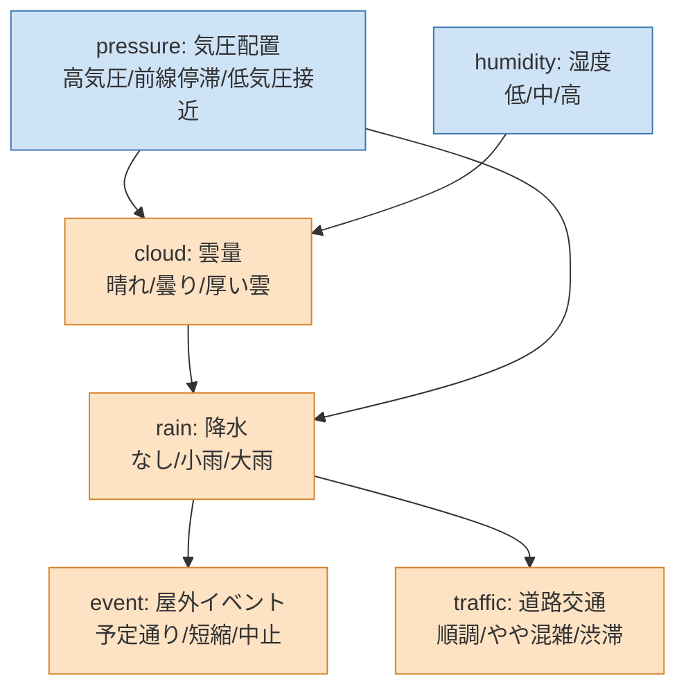
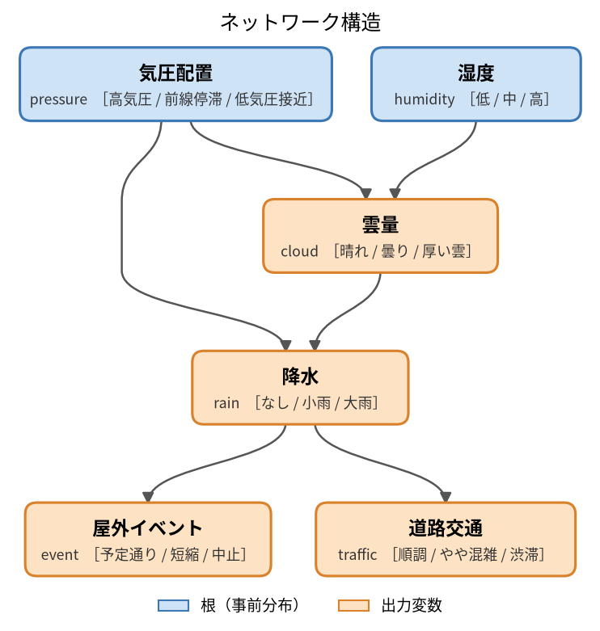
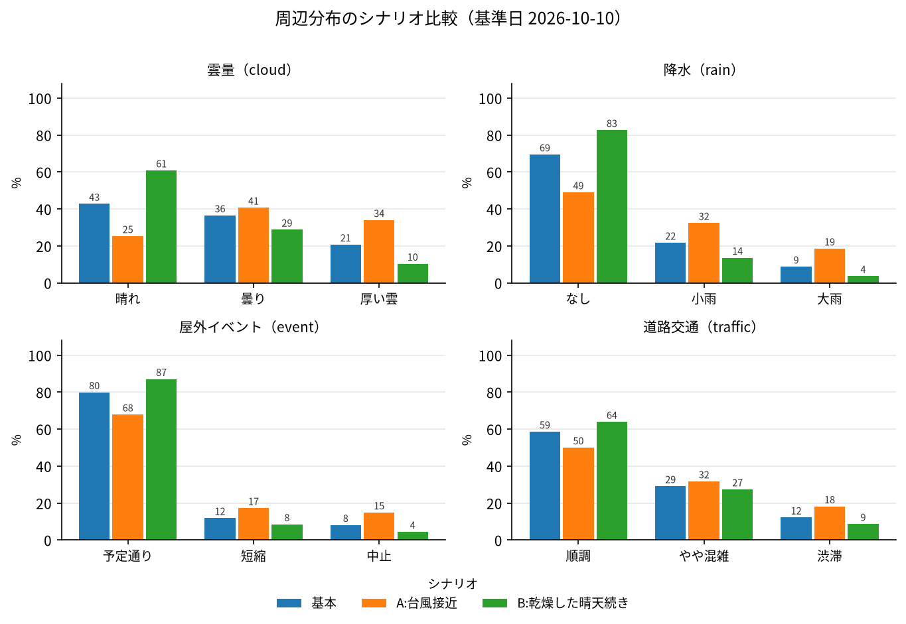
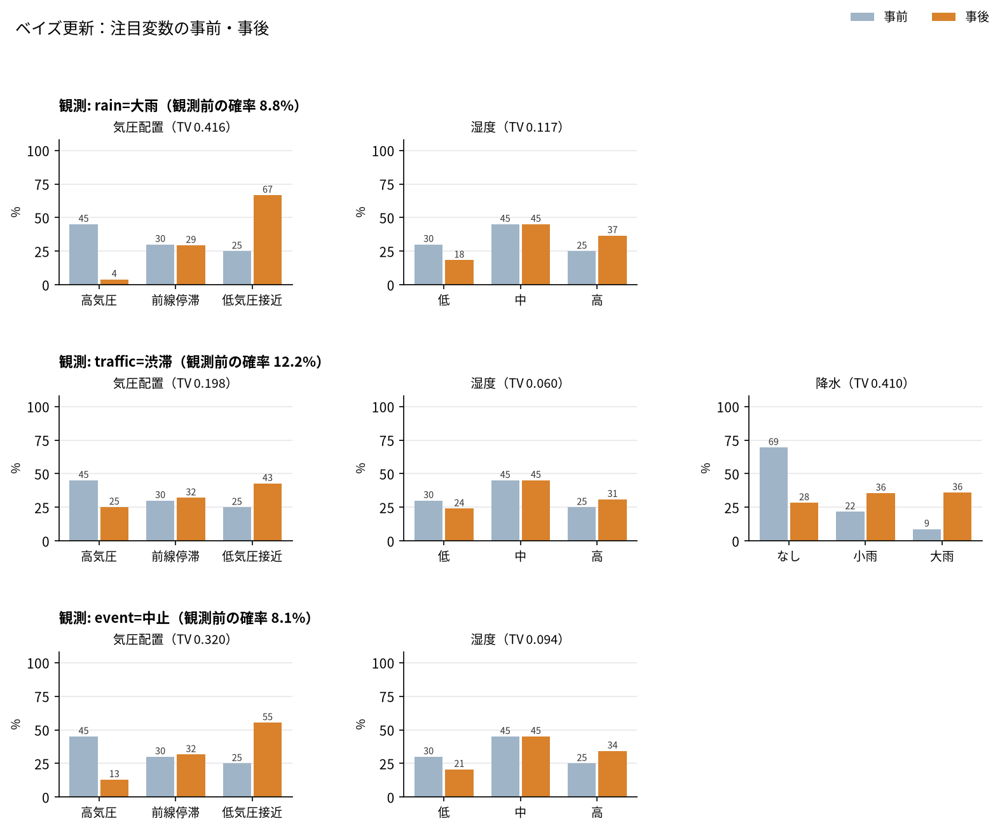
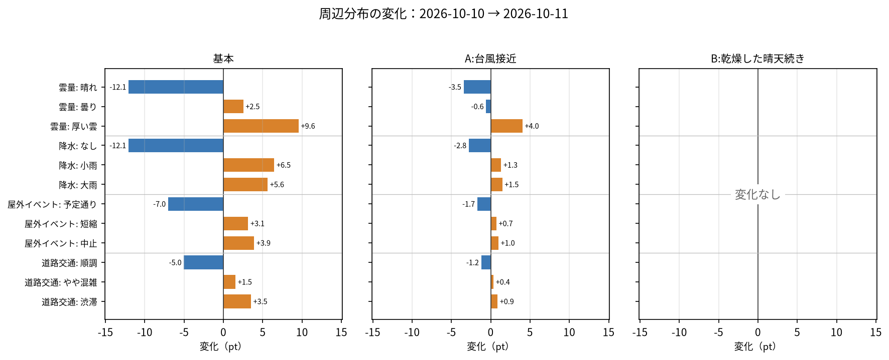
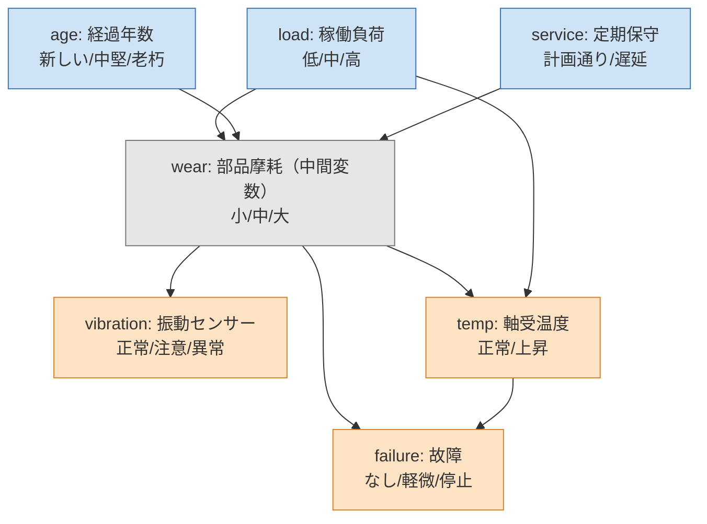
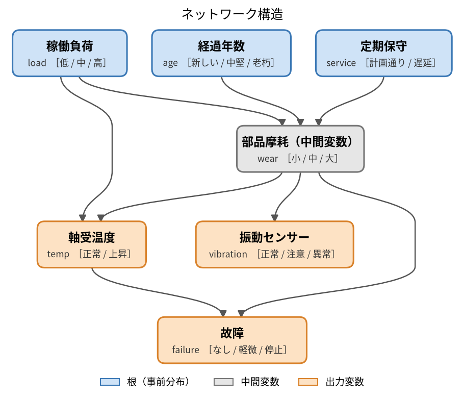
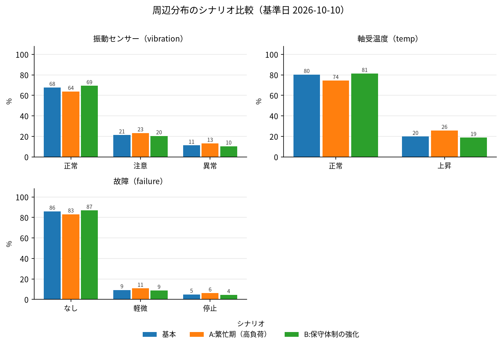
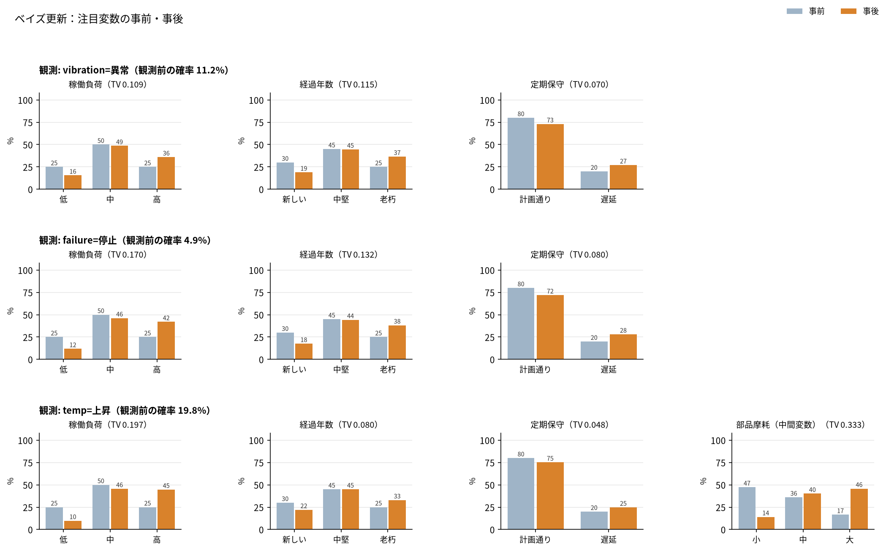

# fxtensor-bayesnet

[English](README.md) | **日本語**

設定ファイル駆動の離散ベイジアンネットワーク推論ツール（[fxtensor-salmon](https://github.com/salmonsnare/fxtensor-salmon) 使用）。

## 概要

本ツールは、事象間の因果関係を条件付き確率で表現し、全体への影響を定量的に評価する意思決定支援ツールです。前提条件や確率は設定ファイルで管理するため、システムを改修することなく迅速に見直せます。複数シナリオの比較分析に加え、観測された結果から要因を逆算する分析にも対応しています。日次で設定と結果を記録するため、判断の根拠と変化の経緯を継続的に追跡できます。

仕組み：

- 各変数は有限個のラベル（例：`晴れ / 曇り / 厚い雲`）をとる離散変数です。
- 親を持たない変数（根）には事前分布、子の変数には「親のラベルの組合せ → 子の分布」の条件付き確率表（マルコフ核）を書きます。
- fxtensor-salmon の `FXTensor` で状態と核を合成して同時分布を作り、シナリオごとの周辺分布、観測による条件付け（ベイズ更新）、`bayesian_inversion` による根の要因の逆算を計算します。
- 毎回、ライブラリでの計算結果を numpy `einsum` の直接計算と突き合わせ、ずれがあれば停止します（結果の `検算` 欄）。
- 同時分布の要素数が 200 万を超えると、自動的に「祖先集合だけの einsum」計算に切り替わります（結果は同じ）。
- `--plot` でネットワーク構造図・シナリオ比較・ベイズ更新・前回からの変化量の図を PNG / SVG で出力できます（matplotlib が必要）。

> 設定に書く確率は利用者の仮定です。結果は仮定の帰結であり、仮定そのものの正しさは保証しません。

## インストール

Python 3.8 以上。PyPI から入れます。

```bash
pip install fxtensor-bayesnet            # 本体（numpy と fxtensor-salmon が入ります）
pip install "fxtensor-bayesnet[plot]"    # 図も使う場合（matplotlib も入ります）
```

開発する場合：

```bash
git clone https://github.com/salmonsnare/fxtensor-bayesnet.git
cd fxtensor-bayesnet
python3 -m venv .venv
. .venv/bin/activate
pip install -e ".[dev]"     # pytest・matplotlib 付き
pytest
```

## 使い方（すぐ試す）

例題の設定は `examples/` にあります（PyPI のパッケージには含まれないので、リポジトリから取得してください）。

```bash
curl -O https://raw.githubusercontent.com/salmonsnare/fxtensor-bayesnet/v0.9.0/examples/weather/config.json
fxtensor-bayesnet --check                       # 既定はカレントディレクトリの config.json
fxtensor-bayesnet --no-write --md               # Markdown を標準出力へ
fxtensor-bayesnet --no-write --plot --out-dir out/   # 図だけ out/ に
# python -m fxtensor_bayesnet ... でも同じ
```

## config の書き方

設定は JSON 1 ファイルです。最小例：

```json
{
  "as_of": "2026-10-10",
  "horizon": "翌日",
  "note": "全確率は仮定値",
  "variables": {
    "cloud": {"name": "雲量", "labels": ["晴れ", "曇り"]},
    "rain":  {"name": "降水", "labels": ["なし", "あり"]}
  },
  "priors": {
    "cloud": {"p": [0.6, 0.4], "reason": "根拠のメモ（任意）"}
  },
  "kernels": {
    "rain": {
      "parents": ["cloud"],
      "reason": "根拠のメモ（任意）",
      "cpt": {
        "晴れ": [0.95, 0.05],
        "曇り": [0.6, 0.4]
      }
    }
  },
  "scenarios": {
    "A:曇りがち": {"cloud": [0.2, 0.8]}
  },
  "observations": [
    {"var": "rain", "label": "あり", "focus": ["cloud"]}
  ],
  "outputs": ["rain"]
}
```

| キー | 必須 | 内容 |
|---|---|---|
| `as_of` | ○ | 基準日（`YYYY-MM-DD`）。スナップショットのフォルダ名になる |
| `horizon` / `note` | | 見通しの期間・注意書き（結果に表示） |
| `variables` | ○ | 変数名 → `{"name": 表示名, "labels": [ラベル…]}`。ラベルは 2 個以上・重複なし |
| `priors` | ○ | 根の変数 → `{"p": [各ラベルの確率], "reason": 任意}`。和は 1 |
| `kernels` | ○ | 子の変数 → `{"parents": [親…], "cpt": {...}, "reason": 任意}` |
| `scenarios` | | シナリオ名 → `{根の変数: 差し替える事前分布}`。「基本」は自動で入る |
| `observations` | | `{"var", "label", "focus"}`。`var=label` を観測したときの事後を計算。`focus` の変数は事前→事後の動き（差・全変動距離 TV・KL）と動きの大きさ順を出す（省略時は根すべて） |
| `outputs` | | 結果表に出す変数（省略時は根以外すべて） |

`cpt` の書き方：

- キーは親のラベルを `parents` の順に `|` でつないだもの（例：親が `["load", "age"]` なら `"高|老朽"`）。
- 値は子のラベル順の確率で、各行の和は 1。
- 親のラベルの全組合せの行が必要です（足りない・余分な行は `--check` でエラー）。
- 各変数は `priors` か `kernels` のどちらか一方にだけ書きます。循環は不可。変数は最大 52 個。

## CLI

```
fxtensor-bayesnet [--config PATH] [options]
```

| オプション | 内容 |
|---|---|
| `--config PATH` | 設定ファイル（既定：カレントディレクトリの `config.json`） |
| `--check` | 設定の検証だけ行う（各行の和=1、欠けた・余分な行、未定義の親、循環など）。エラーは全件表示し終了コード 2 |
| `--no-write` | `results.json` / `results.md` / `model.mmd` を書かず、標準出力だけにする |
| `--md` | 標準出力を Markdown にする（既定は JSON） |
| `--lang ja\|en` | Markdown と図の見出し・凡例の言語（既定 `ja`）。`results.json` のキーは言語によらず固定 |
| `--snapshot` | 設定と結果を `<history-dir>/<as_of>/` に保存（既存なら終了コード 1） |
| `--force` | `--snapshot` の上書きを許可 |
| `--diff [PATH]` | 前回スナップショットとの差分（設定の変更点＋結果の 0.1pt 以上の変化）。PATH 省略時は `as_of` より前で最新の日付 |
| `--format-config` | 設定ファイルを読みやすい形（核の 1 行＝1 行）に整形して書き戻す |
| `--out-dir DIR` | 結果ファイル・図の出力先（既定：設定ファイルと同じフォルダ） |
| `--history-dir DIR` | スナップショットの保存先（既定：設定ファイルと同じフォルダの `history/`） |
| `--plot` | 図を `--out-dir` に出力（下記）。`--no-write` と併用しても図は書く。`--check` のときは無視 |
| `--plot-format F…` | 図の形式 `png` / `svg`（複数指定可。既定 `png`） |
| `--plot-dpi N` | PNG の解像度（既定 150） |

出力ファイル：

- `results.json` … 事前分布、シナリオ別の周辺分布、ベイズ更新、検算
- `results.md` … シナリオ比較表とベイズ更新の要約
- `model.mmd` … 変数と経路の構造図（mermaid。根・中間・出力を色分け）

### 図の出力（`--plot`）

matplotlib が必要です（`pip install "fxtensor-bayesnet[plot]"`）。入っていない状態で `--plot` を付けると、入れ方を表示して終了コード 3 で終わります（図を使わない機能は matplotlib なしで動きます）。

| ファイル | 内容 | 出るとき |
|---|---|---|
| `network.png` | ネットワーク構造図。根（青）・中間変数（灰）・出力変数（橙）を色分けし、階層レイアウトで描く（graphviz 不要） | 通常の実行 |
| `marginals.png` | 出力変数ごとの周辺分布の棒グラフ。シナリオを並べて比較 | 通常の実行 |
| `updates.png` | 観測ごとに、注目変数の事前・事後を並べた棒グラフ（全変動距離 TV 付き） | `observations` があるとき |
| `diff.png` | 前回スナップショットからの周辺分布の変化量（pt）。シナリオごと | `--diff --plot` で、前回の `results.json` があるとき |

```bash
fxtensor-bayesnet --plot                          # 結果ファイル＋図（network / marginals / updates）
fxtensor-bayesnet --plot --plot-format png svg    # PNG と SVG の両方
fxtensor-bayesnet --no-write --plot --out-dir figs/
fxtensor-bayesnet --diff --plot                   # 前回との差分＋ diff.png
```

日本語フォントは Noto Sans CJK JP・IPAexGothic・Hiragino Sans・Yu Gothic・Meiryo などから自動で選びます。見つからない場合は警告を出して既定フォントで描きます（日本語が表示されないことがあります）。使うフォントは環境変数 `FXTENSOR_BAYESNET_FONT` で指定できます。SVG は文字をパスにして保存するので、閲覧環境のフォントに左右されません。

### 日次の運用例

```bash
cd my-model/                         # config.json があるフォルダ
# 1. config.json の as_of・priors・必要なら kernels を更新
fxtensor-bayesnet --check            # 検証
fxtensor-bayesnet --diff             # 前回との差分
fxtensor-bayesnet --snapshot --md    # 実行して results.* を更新し history/<as_of>/ に記録
fxtensor-bayesnet --plot --no-write  # 図を更新
```

## 例

`examples/` に 2 つの例題があります（確率は説明用の仮定値）。それぞれ日本語版 `config.json` と、数値が同じ英語版 `config.en.json` があります。下の図は `python docs/make_images.py` で実際に生成したもので、`docs/images/`（英語版は `docs/images/en/`）にあります。

### 天気（`examples/weather/config.json`）

- シナリオ：「A:台風接近」「B:乾燥した晴天続き」
- 観測：`rain=大雨`、`traffic=渋滞`、`event=中止` から気圧配置・湿度を逆算

構造（mermaid。GitHub ではそのまま図として表示されます）：



ネットワーク構造図（`--plot` の `network.png`）：



周辺分布のシナリオ比較（`marginals.png`）：



ベイズ更新の事前・事後（`updates.png`）。たとえば「大雨」を観測すると、気圧配置の「低気圧接近」が 25% → 67% に上がります：



前回からの変化量（`--diff --plot` の `diff.png`）。翌日に気圧配置と湿度の事前分布を見直した場合の例です。A・B は気圧配置（B は湿度も）をシナリオで上書きしているため、その分だけ変化が小さく（B は変化なし）なります：



### 設備保全（`examples/maintenance/config.json`）

- シナリオ：「A:繁忙期（高負荷）」「B:保守体制の強化」
- 観測：`vibration=異常`、`failure=停止`、`temp=上昇` から負荷・年数・保守状況を逆算
- `wear`（部品摩耗）は `outputs` に入れていない中間変数なので、構造図では灰色になります









実行例（設備保全、`--md` の抜粋）：

```
## failure（故障）
| シナリオ | なし | 軽微 | 停止 |
|---|---|---|---|
| 基本 | 85.9% | 9.2% | 4.9% |
| A:繁忙期（高負荷） | 83.2% | 10.7% | 6.1% |
| B:保守体制の強化 | 86.8% | 8.7% | 4.5% |

### vibration=異常 を観測（観測前の確率 11.2%）
- wear: 小 8.5% / 中 32.2% / 大 59.3%
- 動きの大きさ順(TV): age > load > service
```

## Python から使う

```python
from fxtensor_bayesnet import load_config, run

cfg = load_config("examples/weather/config.json")
res = run(cfg)
print(res["シナリオ"]["A:台風接近"]["周辺"]["rain"])

# 図（matplotlib が必要）
from fxtensor_bayesnet.plot import plot_all, plot_network
plot_network(cfg, "network.svg")
plot_all(res, cfg, "figs", formats=("png",))
```

## 構成

```
src/fxtensor_bayesnet/
  config.py     設定の読み込み・検証・整形・ハッシュ
  network.py    FXTensor による状態・核の組み立て、einsum の直接計算
  inference.py  シナリオ別周辺分布・ベイズ更新・要因の逆算・検算
  report.py     Markdown / mermaid 出力
  history.py    スナップショットと差分
  plot.py       図（構造図・シナリオ比較・ベイズ更新・変化量。matplotlib は optional）
  i18n.py       Markdown と図の文言（日本語・英語）
  cli.py        コマンドライン
tests/          pytest
examples/       例題の config（日本語版・英語版）
docs/images/    README の図（docs/make_images.py で再生成）
```

## 依存ライブラリ

- [fxtensor-salmon](https://github.com/salmonsnare/fxtensor-salmon)（MIT License）… PyPI の `fxtensor-salmon>=1.2.2,<2`。コードは同梱していません。
- numpy
- matplotlib（optional、`[plot]`）… 図の出力のみ

## ライセンス

MIT License。詳しくは [LICENSE](LICENSE) を参照してください。

変更履歴は [CHANGELOG.md](CHANGELOG.md) にあります。
