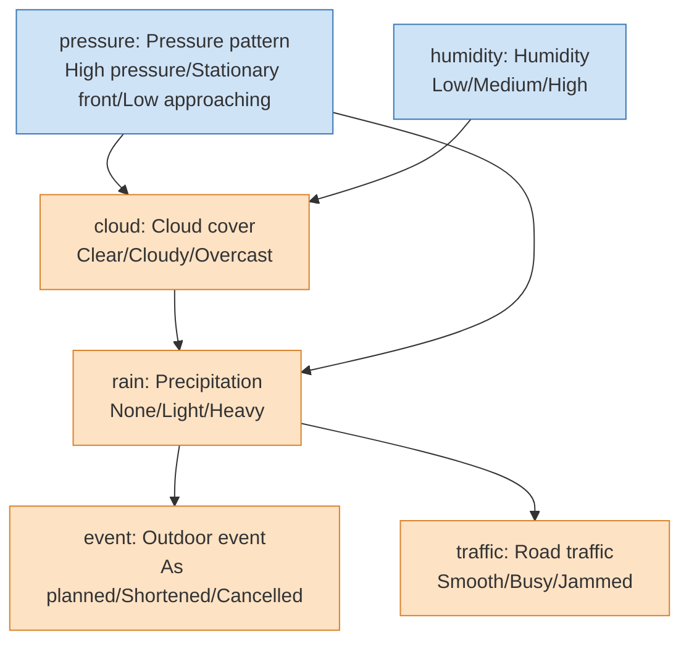
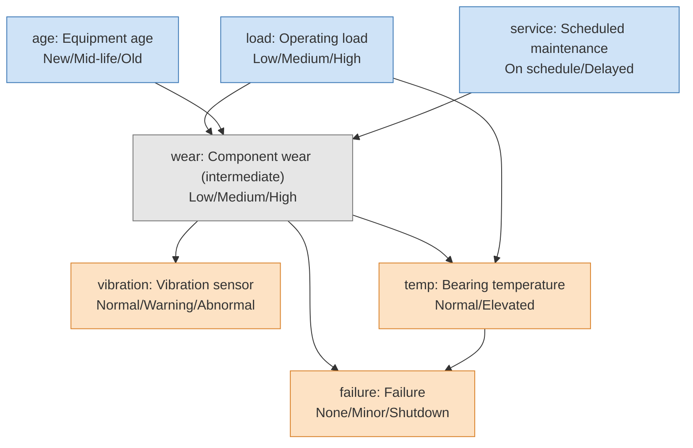

# fxtensor-bayesnet

**English** | [日本語](https://github.com/salmonsnare/fxtensor-bayesnet/blob/main/README-ja.md)

A config-driven inference tool for discrete Bayesian networks, built on [fxtensor-salmon](https://github.com/salmonsnare/fxtensor-salmon).

## Overview

fxtensor-bayesnet is a decision-support tool that expresses cause-and-effect relationships between events as conditional probabilities and quantifies their overall impact. Assumptions and probabilities live in a configuration file, so they can be revised quickly without changing any code. It supports comparing multiple scenarios as well as working backwards from observed outcomes to their likely causes. Because the configuration and results can be recorded daily, the rationale behind each judgement and how it changed over time can be tracked continuously.

How it works:

- Each variable is discrete and takes one of a finite set of labels (e.g. `Clear / Cloudy / Overcast`).
- Variables without parents (roots) get a prior distribution; child variables get a conditional probability table ("parent label combination → child distribution", i.e. a Markov kernel).
- The joint distribution is built by composing states and kernels with fxtensor-salmon's `FXTensor`. From it the tool computes marginals per scenario, conditioning on observations (Bayesian updating), and root-cause inference via `bayesian_inversion`.
- On every run, results computed with the library are cross-checked against a direct numpy `einsum` computation, using unrounded values; any mismatch stops the run (see the `検算` ("checks") field of the results).
- When the joint distribution would exceed 2 million entries, the tool automatically switches to computing over ancestor sets only (same results). Conditioning never builds a dense wiring kernel larger than 1 million entries; above that it sums the joint directly or uses variable elimination.
- Causal questions (0.10.0): `interventions` apply do() to any variable (root or not) by graph surgery, and `effects` report the average causal effect (ACE) next to the observational difference, so confounding becomes visible.
- Observations can combine several pieces of evidence and soft (likelihood) evidence; `sensitivity` ranks the prior / CPT entries a result depends on most.
- `--plot` renders the network structure, scenario comparison, Bayesian updates and day-over-day changes as PNG / SVG (requires matplotlib).

> The probabilities in a config are the user's assumptions. The results are consequences of those assumptions; the tool does not validate the assumptions themselves.

## Installation

Python 3.8 or later. Install from PyPI:

```bash
pip install fxtensor-bayesnet            # core (pulls in numpy and fxtensor-salmon)
pip install "fxtensor-bayesnet[plot]"    # with figures (adds matplotlib)
```

For development:

```bash
git clone https://github.com/salmonsnare/fxtensor-bayesnet.git
cd fxtensor-bayesnet
python3 -m venv .venv
. .venv/bin/activate
pip install -e ".[dev]"     # includes pytest and matplotlib
pytest
```

## Quick start

Example configs live in `examples/` (they are not part of the PyPI package, so fetch them from the repository).

```bash
curl -o config.json https://raw.githubusercontent.com/salmonsnare/fxtensor-bayesnet/v0.11.1/examples/weather/config.en.json
fxtensor-bayesnet --check                            # defaults to ./config.json
fxtensor-bayesnet --no-write --md --lang en          # Markdown to stdout
fxtensor-bayesnet --no-write --plot --lang en --out-dir out/   # figures only, into out/
# python -m fxtensor_bayesnet ... works the same way
```

## Writing a config

A config is a single JSON file. Minimal example:

```json
{
  "as_of": "2026-10-10",
  "horizon": "Next day",
  "note": "All probabilities are assumptions",
  "variables": {
    "cloud": {"name": "Cloud cover", "labels": ["Clear", "Cloudy"]},
    "rain":  {"name": "Precipitation", "labels": ["None", "Some"]}
  },
  "priors": {
    "cloud": {"p": [0.6, 0.4], "reason": "free-text rationale (optional)"}
  },
  "kernels": {
    "rain": {
      "parents": ["cloud"],
      "reason": "free-text rationale (optional)",
      "cpt": {
        "Clear": [0.95, 0.05],
        "Cloudy": [0.6, 0.4]
      }
    }
  },
  "scenarios": {
    "A: Mostly cloudy": {"cloud": [0.2, 0.8]}
  },
  "observations": [
    {"var": "rain", "label": "Some", "focus": ["cloud"]}
  ],
  "outputs": ["rain"]
}
```

| Key | Required | Meaning |
|---|---|---|
| `as_of` | yes | Reference date (`YYYY-MM-DD`); used as the snapshot folder name |
| `horizon` / `note` | | Forecast horizon and a note (shown in the results) |
| `variables` | yes | Variable → `{"name": display name, "labels": [labels…]}`. At least 2 labels, no duplicates |
| `priors` | yes | Root variable → `{"p": [probability per label], "reason": optional}`. Must sum to 1 |
| `kernels` | yes | Child variable → `{"parents": [parents…], "cpt": {...}, "reason": optional}` |
| `scenarios` | | Scenario name → `{root variable: replacement prior}`. A base scenario is always included |
| `observations` | | `{"var", "label", "focus"}`. Computes posteriors given `var=label`. For the `focus` variables it also reports prior→posterior movement (difference, total variation distance TV, KL) and ranks them by movement (defaults to all roots). Instead of `var`/`label`, `{"evidence": {...}, "name": optional}` conditions on several observations jointly and accepts soft evidence (see below) |
| `interventions` | | Name → `{variable: label or [distribution]}`. do() on **any** variable by graph surgery (its kernel is replaced); reports the marginals of `outputs` |
| `effects` | | List of `{"treatment", "outcome", "outcome_label"?, "treated"?, "control"?}`. P(outcome \| do(X=x)) and P(outcome \| X=x) for every level, the ACE (treated − control), the observational difference and their gap. Defaults: last label of the outcome, treated = last label, control = first label. Optional `given_do` / `given` give stratified / conditional ACEs, optional `name` sets the result key (see below) |
| `sensitivity` | | `{"target", "label"?, "delta"? (0.05), "top"? (10)}` or a list of them. One-at-a-time sensitivity of P(target=label) to every prior and CPT entry |
| `outputs` | | Variables shown in the result tables (defaults to all non-root variables) |

Writing a `cpt`:

- Each key joins the parents' labels with `|`, in `parents` order (e.g. with parents `["load", "age"]`: `"High|Old"`).
- Each value lists probabilities in the child's label order; every row must sum to 1.
- Every combination of parent labels needs a row (missing or extra rows are reported by `--check`).
- Each variable goes in exactly one of `priors` or `kernels`. No cycles. Up to 52 variables.
- Variables may be declared in any order in `variables` (roots do not have to come first).

### Interventions, causal effects, evidence and sensitivity

These keys are optional; configs without them give exactly the same results as before. Example additions to the maintenance example (`examples/maintenance/config.en.json`):

```json
"interventions": {
  "Replace worn parts (wear=Low)": {"wear": "Low"},
  "Cool half of the bearings": {"temp": [0.5, 0.5]}
},
"effects": [
  {"treatment": "temp", "outcome": "failure", "outcome_label": "Shutdown"},
  {"treatment": "wear", "outcome": "failure", "outcome_label": "Shutdown", "treated": "High", "control": "Low"}
],
"observations": [
  {"evidence": {"vibration": "Abnormal", "temp": "Elevated"}, "focus": ["load", "age", "service"]},
  {"name": "Vibration probably abnormal (noisy sensor)",
   "evidence": {"vibration": {"likelihood": [0.1, 0.4, 0.9]}}, "focus": ["wear"]}
],
"sensitivity": {"target": "failure", "label": "Shutdown", "delta": 0.05, "top": 5}
```

- **`interventions`**: `{"wear": "Low"}` is a hard do(wear=Low); a list such as `[0.5, 0.5]` is a stochastic intervention. The variable's incoming edges are cut and everything downstream is recomputed; upstream variables keep their priors (unlike conditioning). `scenarios` remain the way to change root priors; do() on a root is the same as a scenario.
- **`effects`**: compares conditioning with intervening. In the example, elevated bearing temperature is associated with +14.9 pt more shutdowns, but the ACE of do(temp) is only +5.8 pt; the +9.1 pt gap is confounding through component wear.
- **`evidence`**: a label string is hard evidence; `{"likelihood": [...]}` is soft (virtual) evidence — non-negative weights P(report \| true label) per label, which need not sum to 1 (e.g. an imperfect sensor or detection). All evidence in one entry is applied jointly. Hard-evidence variables are omitted from the posterior; soft-evidence variables keep one. The key in the results is `name`, or e.g. `vibration=Abnormal, temp=Elevated を観測`.
  With hard evidence only, each update reports `観測前の確率` (`evidence_probability`), the prior probability of the evidence. As soon as an entry contains soft evidence it reports `尤度の期待値` (`expected_likelihood`) instead: the expectation Σ P(x) L(x) of the likelihood weights, which is not a probability and can exceed 1 when the weights do (it is shown as a plain number, not a percentage).
  An observation with probability 0 under the model (e.g. a label whose CPT entries are all 0) cannot be conditioned on. It does not stop the run: a warning is printed, that update is skipped and recorded with `不可能な観測: true` (`impossible`), probability 0 and an empty posterior, and every other observation and section is computed as usual (`updates.png` leaves it out).
- **`sensitivity`**: each parameter (one prior entry or one CPT row entry in the ancestor set of the target) is moved by ±delta (clipped to [0, 1]); the other entries of the same row are rescaled proportionally so the row still sums to 1. For two-label rows only the last label is moved. Results are sorted by swing (a tornado chart with `--plot`).

Excerpt of `--md --lang en` for these additions:

```
### temp → failure=Shutdown
| Level | P(failure=Shutdown ∣ temp=level) (observed) | P(failure=Shutdown ∣ do(temp=level)) (intervened) |
|---|---|---|
| Normal | 1.9% | 2.6% |
| Elevated | 16.8% | 8.4% |

- Observed difference (Elevated − Normal) +14.9pt / average causal effect ACE +5.8pt / gap (confounding) +9.1pt
```

Interventional results are cross-checked against a direct truncated-factorisation einsum on the original network (`介入:切断因子分解との最大差` in the checks).

### Stratified and conditional ACE (`given_do` / `given`, 0.11.0)

Does the effect of X depend on another variable Z (effect modification)? Add `given_do` and/or `given` to an `effects` item instead of writing every do() combination into `interventions`:

```json
{"treatment": "temp", "outcome": "failure", "outcome_label": "Shutdown",
 "given_do": {"wear": ["Low", "High"]},
 "given": {"load": null}}
```

- **`given_do`**: `{Z: [labels]}` — Z is also fixed by intervention. For each stratum z: P(Y=y \| do(X=x), do(Z=z)) for every level x and ACE(z) = P(y \| do(treated), do(z)) − P(y \| do(control), do(z)).
- **`given`**: `{Z: [labels]}` — conditional ACE: X is fixed by intervention and Z is observed in the intervened model, P(Y=y \| do(X=x), Z=z). A stratum with probability 0 under do(X=x) is undefined (`null`, shown as `—`) and a warning is printed.
- A value may be a list of labels, one label, or `null` (all labels). Several variables give the combinations of their labels as strata (e.g. `wear=High, load=Low`). Z must differ from the treatment and the outcome, and a variable cannot be in both keys.
- **Result key (0.11.1)**: an effect is stored under its `name` if given (also kept as `名前` / `name`); otherwise under `X → Y=y`, followed by the stratification when there is one: `X → Y=y | do(Z)` for `given_do`, `X → Y=y | W` for `given`, `X → Y=y | do(Z), W` for both. Effects without `given_do` / `given` keep the plain `X → Y=y` key. So the same (treatment, outcome, outcome_label) can be listed several times with different stratifications. If two effects would still get the same key (e.g. the same `given_do` variable with different labels), `--check` reports a config error and `run()` raises `ConfigError` instead of silently keeping only the last one; give them different `name`s.
- Each stratum is stored under `層別ACE(given_do)` / `条件付きACE(given)` (`stratified_ace_given_do` / `conditional_ace_given`) of the effect, together with the difference between the last and the first stratum (`層間のACEの差(最後−最初)`, `ace_difference_last_minus_first`). Markdown adds a table per stratification and `effects.png` adds a bar panel of the stratum ACEs (dashed line: overall ACE). Effects without these keys are unchanged.

In the maintenance example the ACE of do(temp) is +1.5 pt when wear is fixed to Low and +20.0 pt when it is fixed to High:

```
#### Stratified ACE (wear fixed by intervention: given_do)

| Stratum | P(failure=Shutdown ∣ do(temp=Normal), do(stratum)) | P(failure=Shutdown ∣ do(temp=Elevated), do(stratum)) | ACE |
|---|---|---|---|
| wear=Low | 0.5% | 2.0% | +1.5pt |
| wear=High | 10.0% | 30.0% | +20.0pt |

- Difference in ACE between strata (wear=High − wear=Low) +18.5pt
```

If a treatment level has probability 0 under the model, P(outcome \| X=x) is undefined: `results.json` has `null` and lists the level in `観測確率0の水準` (`zero_probability_levels`), a warning is printed, Markdown shows `—` with a note, and `effects.png` draws no observed bar for it but marks it "undefined (P=0)" (the do() side and the ACE are still defined).

## CLI

```
fxtensor-bayesnet [--config PATH] [options]
```

| Option | Meaning |
|---|---|
| `--config PATH` | Config file (default: `config.json` in the current directory) |
| `--check` | Validate the config only (rows sum to 1, missing/extra rows, undefined parents, cycles, …). Reports all errors and exits with code 2 |
| `--no-write` | Do not write `results.json` / `results.md` / `model.mmd`; print to stdout only |
| `--md` | Print Markdown instead of JSON |
| `--lang ja\|en` | Language of Markdown and figure titles/legends (default `ja`). Does not affect the keys in `results.json` |
| `--json-keys ja\|en` | Language of the keys in `results.json` and in the JSON printed to stdout (default `ja`, unchanged from 0.9). Snapshots in `history/` always use the Japanese keys so that `--diff` keeps working. See "Result keys" below |
| `--snapshot` | Save the config and results to `<history-dir>/<as_of>/`. If that folder already exists (and `--force` is not given), the run stops with exit code 1 before writing anything (no results, figures or snapshot) |
| `--force` | Allow `--snapshot` to overwrite |
| `--diff [PATH]` | Diff against a snapshot (config changes, including reasons and the rows of re-wired kernels, plus result changes of 0.1 pt or more). PATH may be a snapshot folder (its `config.json` and `results.json` are used) or a `config.json` file; a missing path exits with code 2. Without PATH, the latest snapshot dated **strictly before** `as_of` is used — a snapshot with the same date as `as_of` is never picked automatically (pass it explicitly, e.g. `--diff history/2026-10-10`) |
| `--format-config` | Rewrite the config in a readable layout (one kernel row per line) |
| `--out-dir DIR` | Where results and figures go (default: the config's folder) |
| `--history-dir DIR` | Where snapshots go (default: `history/` next to the config) |
| `--plot` | Write figures to `--out-dir` (see below). Figures are written even with `--no-write`; ignored with `--check` |
| `--plot-format F…` | Figure format(s): `png` / `svg` (several allowed; default `png`) |
| `--plot-dpi N` | PNG resolution (default 150) |

Output files:

- `results.json` – priors, marginals per scenario, Bayesian updates, interventions, causal effects, sensitivity, checks
- `results.md` – scenario tables and a summary of the Bayesian updates
- `model.mmd` – network structure as mermaid (roots, intermediate and output variables colour-coded)

### Figures (`--plot`)

Requires matplotlib (`pip install "fxtensor-bayesnet[plot]"`). If it is missing, `--plot` prints installation instructions and exits with code 3 (everything else works without matplotlib).

| File | Contents | When |
|---|---|---|
| `network.png` | Network structure. Roots (blue), intermediate (grey) and output variables (orange), drawn with a layered layout (no graphviz needed) | normal run |
| `marginals.png` | Bar charts of each output variable's marginal, scenarios side by side | normal run |
| `updates.png` | For each observation, prior vs posterior of the focus variables (with TV distance) | when `observations` is set |
| `effects.png` | For each effect, observed P(outcome \| X=x) next to intervened P(outcome \| do(X=x)), annotated with the observed difference and the ACE; levels with probability 0 are marked "undefined" instead of drawn as 0. Stratum ACEs (`given_do` / `given`) get their own panels | when `effects` is set |
| `sensitivity.png` | Tornado chart of the sensitivity analysis | when `sensitivity` is set |
| `diff.png` | Change in marginals (pt) since the previous snapshot, per scenario | `--diff --plot` with a previous `results.json` |

```bash
fxtensor-bayesnet --plot                          # results + figures (network / marginals / updates)
fxtensor-bayesnet --plot --plot-format png svg    # both PNG and SVG
fxtensor-bayesnet --no-write --plot --lang en --out-dir figs/
fxtensor-bayesnet --diff --plot                   # diff + diff.png
```

A font that can display Japanese (Noto Sans CJK JP, IPAexGothic, Hiragino Sans, Yu Gothic, Meiryo, …) is picked automatically so that Japanese labels render. If none is found, a warning is issued and the default font is used. Set the `FXTENSOR_BAYESNET_FONT` environment variable to choose a font. SVGs store text as paths, so they don't depend on the viewer's fonts.

### Daily workflow

```bash
cd my-model/                         # folder containing config.json
# 1. update as_of, priors and (if needed) kernels in config.json
fxtensor-bayesnet --check            # validate
fxtensor-bayesnet --diff             # changes since the previous snapshot (dated before as_of)
fxtensor-bayesnet --snapshot --md    # run, update results.*, record history/<as_of>/
fxtensor-bayesnet --plot --no-write  # refresh figures
```

## Examples

`examples/` has three examples (probabilities are illustrative). Weather and maintenance each come as a Japanese `config.json` and a numerically identical English `config.en.json`; the ecology example is English only. The figures below were generated from the English configs with `python docs/make_images.py` and are stored in `docs/images/en/` (Japanese versions in `docs/images/`).

### Weather (`examples/weather/config.en.json`)

- Scenarios: "A: Typhoon approaching", "B: Dry spell"
- Observations: infer the pressure pattern and humidity from `rain=Heavy`, `traffic=Jammed`, `event=Cancelled`

Structure (mermaid; rendered as a diagram on GitHub):



Network structure (`network.png` from `--plot`):


Marginals by scenario (`marginals.png`):


Bayesian update, prior vs posterior (`updates.png`). For example, observing heavy rain raises "Low approaching" for the pressure pattern from 25% to 67%:


Day-over-day change (`diff.png` from `--diff --plot`): the next day, the pressure and humidity priors are revised. Scenarios A and B override the pressure prior (B also humidity), so they change less (B not at all):


### Equipment maintenance (`examples/maintenance/config.en.json`)

- Scenarios: "A: Peak season (high load)", "B: Stronger maintenance"
- Observations: infer load, age and maintenance status from `vibration=Abnormal`, `failure=Shutdown`, `temp=Elevated`
- `wear` (component wear) is not in `outputs`, so it is an intermediate variable and drawn in grey




Sample output (maintenance, excerpt of `--md --lang en`):

```
## failure (Failure)
| Scenario | None | Minor | Shutdown |
|---|---|---|---|
| Base | 85.9% | 9.2% | 4.9% |
| A: Peak season (high load) | 83.2% | 10.7% | 6.1% |
| B: Stronger maintenance | 86.8% | 8.7% | 4.5% |

### Observed vibration=Abnormal (prior probability 11.2%)
- wear: Low 8.5% / Medium 32.2% / High 59.3%
- Ranking by movement (TV): age > load > service
```

### Ecology: host–parasite–parasitoid cascade (`examples/ecology_host_parasitoid/`)

Observation vs intervention with `interventions`, `effects`, joint and soft evidence and `sensitivity`; see its [README](https://github.com/salmonsnare/fxtensor-bayesnet/blob/main/examples/ecology_host_parasitoid/README.md). **All numbers are illustrative placeholders**; the topic is inspired by Coroller-Chouraki et al. (bioRxiv, https://doi.org/10.64898/2026.10.06.757064), but the values are not estimates from that paper.


## Result keys

By default the keys of `results.json` are Japanese (unchanged since 0.9). With `--json-keys en` (or `to_english_keys(res)` in Python) they are English; names you chose (variables, labels, scenarios, interventions) are never translated, and an observation key `X=x を観測` becomes `X=x`. The default may switch to English in a future major version.

| Japanese | English | Japanese | English |
|---|---|---|---|
| `基準日` | `as_of` | `介入` / `介入内容` | `interventions` / `do` |
| `シナリオ` / `基本` | `scenarios` / `base` | `因果効果` | `effects` |
| `上書き` / `周辺` | `overrides` / `marginals` | `P(結果\|do(処置))` / `P(結果\|処置)(観測)` | `p_outcome_do` / `p_outcome_observed` |
| `ベイズ更新(基本)` | `updates_base` | `ACE` / `観測上の差` | `ace` / `observed_difference` |
| `観測前の確率` / `事後` | `evidence_probability` / `posterior` | `交絡による差(観測上の差−ACE)` | `confounding_gap` |
| `証拠` / `尤度` | `evidence` / `likelihood` | `感度分析` / `上位` | `sensitivity` / `top` |
| `注目変数の事前` / `注目変数の動き` | `focus_prior` / `focus_movement` | `幅(pt)` | `swing_pt` |
| `動きの大きさ順(TV)` | `ranking_by_tv` | `検算` | `checks` |
| `尤度の期待値` | `expected_likelihood` | `不可能な観測` | `impossible` |
| `層別ACE(given_do)` / `条件付きACE(given)` | `stratified_ace_given_do` / `conditional_ace_given` | `層` / `条件` / `条件の値` | `strata` / `given` / `given_values` |
| `P(結果\|do(処置),do(層))` / `P(結果\|do(処置),層)` | `p_outcome_do_given_do` / `p_outcome_do_given` | `P(層\|do(処置))` | `p_stratum_do` |
| `層間のACEの差(最後−最初)` | `ace_difference_last_minus_first` | `観測確率0の水準` | `zero_probability_levels` |

The full mapping is `fxtensor_bayesnet.keys.KEY_MAP`.

## Python API

```python
from fxtensor_bayesnet import load_config, run

cfg = load_config("examples/weather/config.en.json")
res = run(cfg)
# result keys are Japanese by default: "シナリオ" = scenarios, "周辺" = marginals, "基本" = base
print(res["シナリオ"]["A: Typhoon approaching"]["周辺"]["rain"])

from fxtensor_bayesnet import to_english_keys, do_config, Engine, Net
en = to_english_keys(res)                      # English keys
print(en["scenarios"]["base"]["marginals"]["rain"])

# joint / soft evidence and do() directly
net = Net(cfg)
priors = {v: cfg["priors"][v]["p"] for v in net.roots}
p_e, post = Engine(net, priors).posterior_raw({"rain": "Heavy", "traffic": {"likelihood": [0.1, 0.3, 0.9]}})
surgered = do_config(cfg, {"cloud": "Overcast"})   # derived config with the kernel of "cloud" replaced

# figures (requires matplotlib)
from fxtensor_bayesnet.plot import plot_all, plot_network
plot_network(cfg, "network.svg", lang="en")
plot_all(res, cfg, "figs", formats=("png",), lang="en")
```

## Layout

```
src/fxtensor_bayesnet/
  config.py     loading, validation, formatting and hashing of configs
  network.py    building states/kernels with FXTensor; direct einsum computation
  inference.py  marginals per scenario, Bayesian updates (joint / soft evidence), root-cause inference,
                interventions, causal effects, sensitivity, checks
  causal.py     graph surgery (do), effect defaults, one-at-a-time sensitivity
  keys.py       English keys for results JSON
  report.py     Markdown / mermaid output
  history.py    snapshots and diffs
  plot.py       figures (structure, scenarios, updates, changes; matplotlib optional)
  i18n.py       strings for Markdown and figures (Japanese / English)
  cli.py        command line
tests/          pytest
examples/       example configs (Japanese and English; ecology example in English)
docs/images/    README figures (regenerate with docs/make_images.py)
```

## Dependencies

- [fxtensor-salmon](https://github.com/salmonsnare/fxtensor-salmon) (MIT License) – `fxtensor-salmon>=1.2.2,<2` from PyPI; not vendored.
- numpy
- matplotlib (optional, `[plot]`) – only for figures

## License

MIT License. See [LICENSE](https://github.com/salmonsnare/fxtensor-bayesnet/blob/main/LICENSE).

See [CHANGELOG.md](https://github.com/salmonsnare/fxtensor-bayesnet/blob/main/CHANGELOG.md) for the release history.
