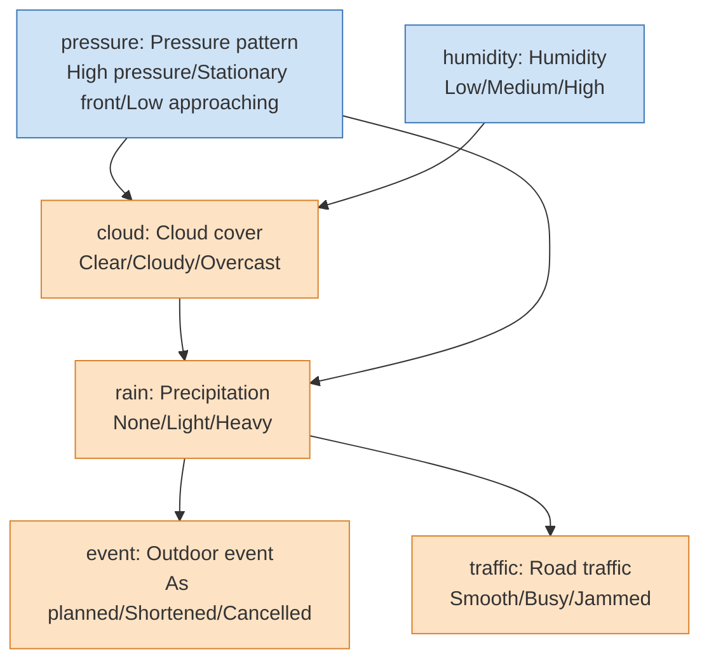
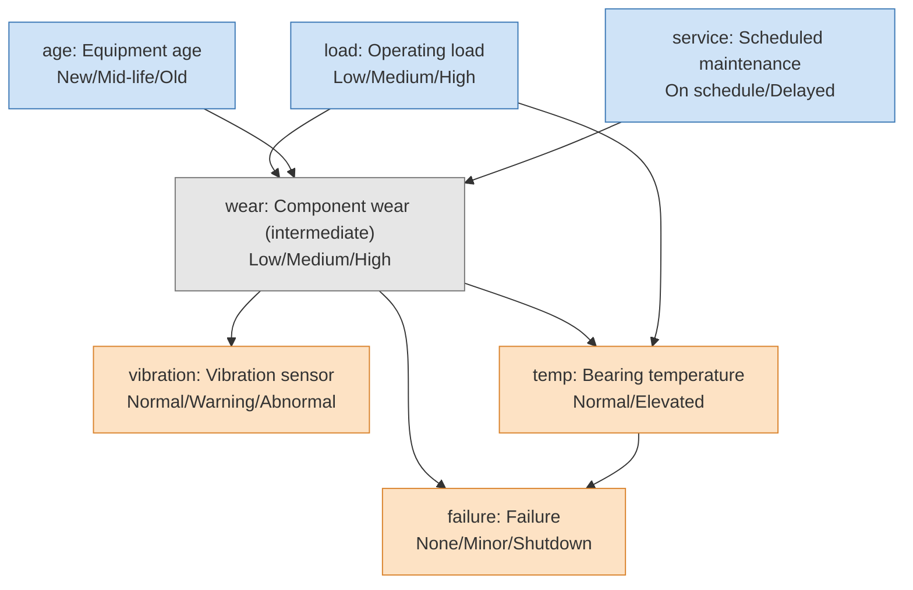

# fxtensor-bayesnet

**English** | [日本語](https://github.com/salmonsnare/fxtensor-bayesnet/blob/main/README-ja.md)

A config-driven inference tool for discrete Bayesian networks, built on [fxtensor-salmon](https://github.com/salmonsnare/fxtensor-salmon).

## Overview

fxtensor-bayesnet is a decision-support tool that expresses cause-and-effect relationships between events as conditional probabilities and quantifies their overall impact. Assumptions and probabilities live in a configuration file, so they can be revised quickly without changing any code. It supports comparing multiple scenarios as well as working backwards from observed outcomes to their likely causes. Because the configuration and results can be recorded daily, the rationale behind each judgement and how it changed over time can be tracked continuously.

How it works:

- Each variable is discrete and takes one of a finite set of labels (e.g. `Clear / Cloudy / Overcast`).
- Variables without parents (roots) get a prior distribution; child variables get a conditional probability table ("parent label combination → child distribution", i.e. a Markov kernel).
- The joint distribution is built by composing states and kernels with fxtensor-salmon's `FXTensor`. From it the tool computes marginals per scenario, conditioning on observations (Bayesian updating), and root-cause inference via `bayesian_inversion`.
- On every run, results computed with the library are cross-checked against a direct numpy `einsum` computation; any mismatch stops the run (see the `検算` ("checks") field of the results).
- When the joint distribution would exceed 2 million entries, the tool automatically switches to computing over ancestor sets only (same results).
- `--plot` renders the network structure, scenario comparison, Bayesian updates and day-over-day changes as PNG / SVG (requires matplotlib).

> The probabilities in a config are the user's assumptions. The results are consequences of those assumptions; the tool does not validate the assumptions themselves.

## Installation

Python 3.8 or later. Install from PyPI:

```bash
pip install fxtensor-bayesnet            # core (pulls in numpy and fxtensor-salmon)
pip install "fxtensor-bayesnet[plot]"    # with figures (adds matplotlib)
```

For development:

```bash
git clone https://github.com/salmonsnare/fxtensor-bayesnet.git
cd fxtensor-bayesnet
python3 -m venv .venv
. .venv/bin/activate
pip install -e ".[dev]"     # includes pytest and matplotlib
pytest
```

## Quick start

Example configs live in `examples/` (they are not part of the PyPI package, so fetch them from the repository).

```bash
curl -o config.json https://raw.githubusercontent.com/salmonsnare/fxtensor-bayesnet/v0.9.0/examples/weather/config.en.json
fxtensor-bayesnet --check                            # defaults to ./config.json
fxtensor-bayesnet --no-write --md --lang en          # Markdown to stdout
fxtensor-bayesnet --no-write --plot --lang en --out-dir out/   # figures only, into out/
# python -m fxtensor_bayesnet ... works the same way
```

## Writing a config

A config is a single JSON file. Minimal example:

```json
{
  "as_of": "2026-10-10",
  "horizon": "Next day",
  "note": "All probabilities are assumptions",
  "variables": {
    "cloud": {"name": "Cloud cover", "labels": ["Clear", "Cloudy"]},
    "rain":  {"name": "Precipitation", "labels": ["None", "Some"]}
  },
  "priors": {
    "cloud": {"p": [0.6, 0.4], "reason": "free-text rationale (optional)"}
  },
  "kernels": {
    "rain": {
      "parents": ["cloud"],
      "reason": "free-text rationale (optional)",
      "cpt": {
        "Clear": [0.95, 0.05],
        "Cloudy": [0.6, 0.4]
      }
    }
  },
  "scenarios": {
    "A: Mostly cloudy": {"cloud": [0.2, 0.8]}
  },
  "observations": [
    {"var": "rain", "label": "Some", "focus": ["cloud"]}
  ],
  "outputs": ["rain"]
}
```

| Key | Required | Meaning |
|---|---|---|
| `as_of` | yes | Reference date (`YYYY-MM-DD`); used as the snapshot folder name |
| `horizon` / `note` | | Forecast horizon and a note (shown in the results) |
| `variables` | yes | Variable → `{"name": display name, "labels": [labels…]}`. At least 2 labels, no duplicates |
| `priors` | yes | Root variable → `{"p": [probability per label], "reason": optional}`. Must sum to 1 |
| `kernels` | yes | Child variable → `{"parents": [parents…], "cpt": {...}, "reason": optional}` |
| `scenarios` | | Scenario name → `{root variable: replacement prior}`. A base scenario is always included |
| `observations` | | `{"var", "label", "focus"}`. Computes posteriors given `var=label`. For the `focus` variables it also reports prior→posterior movement (difference, total variation distance TV, KL) and ranks them by movement (defaults to all roots) |
| `outputs` | | Variables shown in the result tables (defaults to all non-root variables) |

Writing a `cpt`:

- Each key joins the parents' labels with `|`, in `parents` order (e.g. with parents `["load", "age"]`: `"High|Old"`).
- Each value lists probabilities in the child's label order; every row must sum to 1.
- Every combination of parent labels needs a row (missing or extra rows are reported by `--check`).
- Each variable goes in exactly one of `priors` or `kernels`. No cycles. Up to 52 variables.

## CLI

```
fxtensor-bayesnet [--config PATH] [options]
```

| Option | Meaning |
|---|---|
| `--config PATH` | Config file (default: `config.json` in the current directory) |
| `--check` | Validate the config only (rows sum to 1, missing/extra rows, undefined parents, cycles, …). Reports all errors and exits with code 2 |
| `--no-write` | Do not write `results.json` / `results.md` / `model.mmd`; print to stdout only |
| `--md` | Print Markdown instead of JSON |
| `--lang ja\|en` | Language of Markdown and figure titles/legends (default `ja`). The keys in `results.json` are fixed regardless of language |
| `--snapshot` | Save the config and results to `<history-dir>/<as_of>/` (exit code 1 if it already exists) |
| `--force` | Allow `--snapshot` to overwrite |
| `--diff [PATH]` | Diff against the previous snapshot (config changes plus result changes of 0.1 pt or more). Without PATH, the latest date before `as_of` is used |
| `--format-config` | Rewrite the config in a readable layout (one kernel row per line) |
| `--out-dir DIR` | Where results and figures go (default: the config's folder) |
| `--history-dir DIR` | Where snapshots go (default: `history/` next to the config) |
| `--plot` | Write figures to `--out-dir` (see below). Figures are written even with `--no-write`; ignored with `--check` |
| `--plot-format F…` | Figure format(s): `png` / `svg` (several allowed; default `png`) |
| `--plot-dpi N` | PNG resolution (default 150) |

Output files:

- `results.json` – priors, marginals per scenario, Bayesian updates, checks
- `results.md` – scenario tables and a summary of the Bayesian updates
- `model.mmd` – network structure as mermaid (roots, intermediate and output variables colour-coded)

### Figures (`--plot`)

Requires matplotlib (`pip install "fxtensor-bayesnet[plot]"`). If it is missing, `--plot` prints installation instructions and exits with code 3 (everything else works without matplotlib).

| File | Contents | When |
|---|---|---|
| `network.png` | Network structure. Roots (blue), intermediate (grey) and output variables (orange), drawn with a layered layout (no graphviz needed) | normal run |
| `marginals.png` | Bar charts of each output variable's marginal, scenarios side by side | normal run |
| `updates.png` | For each observation, prior vs posterior of the focus variables (with TV distance) | when `observations` is set |
| `diff.png` | Change in marginals (pt) since the previous snapshot, per scenario | `--diff --plot` with a previous `results.json` |

```bash
fxtensor-bayesnet --plot                          # results + figures (network / marginals / updates)
fxtensor-bayesnet --plot --plot-format png svg    # both PNG and SVG
fxtensor-bayesnet --no-write --plot --lang en --out-dir figs/
fxtensor-bayesnet --diff --plot                   # diff + diff.png
```

A font that can display Japanese (Noto Sans CJK JP, IPAexGothic, Hiragino Sans, Yu Gothic, Meiryo, …) is picked automatically so that Japanese labels render. If none is found, a warning is issued and the default font is used. Set the `FXTENSOR_BAYESNET_FONT` environment variable to choose a font. SVGs store text as paths, so they don't depend on the viewer's fonts.

### Daily workflow

```bash
cd my-model/                         # folder containing config.json
# 1. update as_of, priors and (if needed) kernels in config.json
fxtensor-bayesnet --check            # validate
fxtensor-bayesnet --diff             # changes since the previous snapshot
fxtensor-bayesnet --snapshot --md    # run, update results.*, record history/<as_of>/
fxtensor-bayesnet --plot --no-write  # refresh figures
```

## Examples

`examples/` has two examples (probabilities are illustrative). Each comes as a Japanese `config.json` and a numerically identical English `config.en.json`. The figures below were generated from the English configs with `python docs/make_images.py` and are stored in `docs/images/en/` (Japanese versions in `docs/images/`).

### Weather (`examples/weather/config.en.json`)

- Scenarios: "A: Typhoon approaching", "B: Dry spell"
- Observations: infer the pressure pattern and humidity from `rain=Heavy`, `traffic=Jammed`, `event=Cancelled`

Structure (mermaid; rendered as a diagram on GitHub):



Network structure (`network.png` from `--plot`):


Marginals by scenario (`marginals.png`):


Bayesian update, prior vs posterior (`updates.png`). For example, observing heavy rain raises "Low approaching" for the pressure pattern from 25% to 67%:


Day-over-day change (`diff.png` from `--diff --plot`): the next day, the pressure and humidity priors are revised. Scenarios A and B override the pressure prior (B also humidity), so they change less (B not at all):


### Equipment maintenance (`examples/maintenance/config.en.json`)

- Scenarios: "A: Peak season (high load)", "B: Stronger maintenance"
- Observations: infer load, age and maintenance status from `vibration=Abnormal`, `failure=Shutdown`, `temp=Elevated`
- `wear` (component wear) is not in `outputs`, so it is an intermediate variable and drawn in grey




Sample output (maintenance, excerpt of `--md --lang en`):

```
## failure (Failure)
| Scenario | None | Minor | Shutdown |
|---|---|---|---|
| Base | 85.9% | 9.2% | 4.9% |
| A: Peak season (high load) | 83.2% | 10.7% | 6.1% |
| B: Stronger maintenance | 86.8% | 8.7% | 4.5% |

### Observed vibration=Abnormal (prior probability 11.2%)
- wear: Low 8.5% / Medium 32.2% / High 59.3%
- Ranking by movement (TV): age > load > service
```

## Python API

```python
from fxtensor_bayesnet import load_config, run

cfg = load_config("examples/weather/config.en.json")
res = run(cfg)
# result keys are fixed (Japanese): "シナリオ" = scenarios, "周辺" = marginals, "基本" = base
print(res["シナリオ"]["A: Typhoon approaching"]["周辺"]["rain"])

# figures (requires matplotlib)
from fxtensor_bayesnet.plot import plot_all, plot_network
plot_network(cfg, "network.svg", lang="en")
plot_all(res, cfg, "figs", formats=("png",), lang="en")
```

## Layout

```
src/fxtensor_bayesnet/
  config.py     loading, validation, formatting and hashing of configs
  network.py    building states/kernels with FXTensor; direct einsum computation
  inference.py  marginals per scenario, Bayesian updates, root-cause inference, checks
  report.py     Markdown / mermaid output
  history.py    snapshots and diffs
  plot.py       figures (structure, scenarios, updates, changes; matplotlib optional)
  i18n.py       strings for Markdown and figures (Japanese / English)
  cli.py        command line
tests/          pytest
examples/       example configs (Japanese and English)
docs/images/    README figures (regenerate with docs/make_images.py)
```

## Dependencies

- [fxtensor-salmon](https://github.com/salmonsnare/fxtensor-salmon) (MIT License) – `fxtensor-salmon>=1.2.2,<2` from PyPI; not vendored.
- numpy
- matplotlib (optional, `[plot]`) – only for figures

## License

MIT License. See [LICENSE](https://github.com/salmonsnare/fxtensor-bayesnet/blob/main/LICENSE).

See [CHANGELOG.md](https://github.com/salmonsnare/fxtensor-bayesnet/blob/main/CHANGELOG.md) for the release history.
