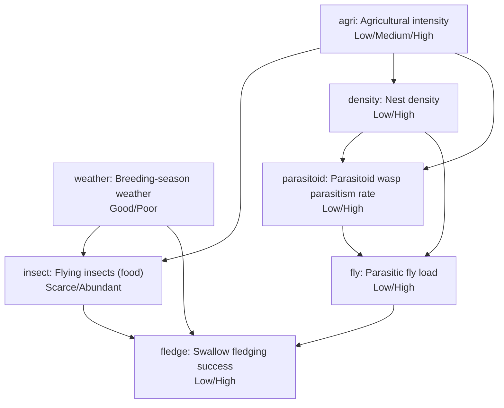

# Example: observation vs intervention in a host–parasite–parasitoid cascade

> **All numbers in this example are illustrative placeholders.** They were chosen by hand to make the mechanics
> visible and are **not estimates** from data or from any study. The topic is inspired by
> Coroller-Chouraki et al. on bioRxiv (<https://doi.org/10.64898/2026.10.06.757064>; agricultural intensity and the
> barn swallow – parasitic fly – parasitoid wasp system), but the structure is a simplified hypothesis and the
> values are **not estimates from that paper**. Do not cite these results as findings about the real system.

The question the example illustrates: nests with a higher parasitism rate by the parasitoid wasp also fledge
more chicks. How much of that association is causal? What would releasing parasitoids, removing flies from nests,
or changing nest density do to fledging success?

## Model



Agricultural intensity is a common cause of food supply, nest density and parasitism, so the observed association
between parasitism and fledging is confounded.

## What the config uses

| Key | In this example |
|---|---|
| `scenarios` | do() on the roots: high intensity everywhere, extensification, a poor-weather season |
| `interventions` | do() on non-root nodes by graph surgery: release parasitoids (`parasitoid=High`), remove flies (`fly=Low`), and a stochastic intervention that treats half of the nests (`fly: [0.5, 0.5]`) |
| `effects` | P(fledge=High \| X=x) (observed) vs P(fledge=High \| do(X=x)) for X = parasitoid, fly, density, with the ACE and the gap between them |
| `observations` | a single observation, joint evidence (`fly=High` and `weather=Poor`), and soft evidence for an imperfect fly count (`{"likelihood": [0.2, 0.9]}`) |
| `sensitivity` | which prior / CPT entries P(fledge=High) depends on most (±0.05) |

## Run

```bash
pip install "fxtensor-bayesnet[plot]>=0.10"
cd examples/ecology_host_parasitoid
fxtensor-bayesnet --config config.json --no-write --md --lang en     # full report
fxtensor-bayesnet --config config.json --out-dir out --plot --lang en --json-keys en
python run_example.py              # observed-vs-intervened table, verified independently
```

`run_example.py` prints the table below and re-computes every P(fledge=High | do(X=x)) with a plain numpy
truncated factorisation that does not use the library's inference code.

## Results (illustrative placeholder numbers)

| X | P(High \| X=Low) observed | P(High \| X=High) observed | observed difference | P(High \| do(X=Low)) | P(High \| do(X=High)) | ACE |
|---|---|---|---|---|---|---|
| parasitoid | 59.7% | 64.5% | **+4.9 pt** | 60.6% | 63.4% | **+2.9 pt** |
| fly | 68.0% | 54.9% | **−13.0 pt** | 67.9% | 55.0% | **−12.8 pt** |
| density | 62.2% | 61.5% | **−0.7 pt** | 63.0% | 60.5% | **−2.5 pt** |

(Differences are computed from unrounded values.)

How to read it, under these placeholder assumptions only:

- **parasitoid**: about 40% of the observed difference (+4.9 pt) is confounding (low-intensity land has both more
  parasitoids and more food). Releasing parasitoids would gain only +2.9 pt.
- **density**: almost no association (−0.7 pt), yet intervening shows a harmful effect (−2.5 pt). Dense nesting is
  more common on food-rich, low-intensity land, which masks the harm in observational data.
- **fly**: confounding is weak, so observation and intervention almost agree.

`--plot` writes `effects.png` (observed vs intervened bars) and `sensitivity.png` (tornado chart) in addition to the
usual figures.


## Limits

- The CPTs are written by hand; the tool does not estimate them from data, and their uncertainty is not propagated.
- Discretising rates and counts into two or three levels loses information.
- An ACE here is a consequence of the assumed graph and CPTs, not evidence for them.
